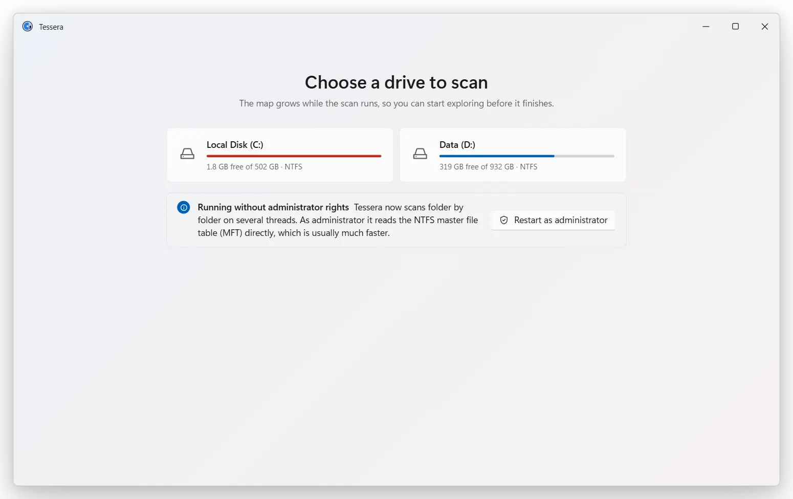

<div align="center">


<h1>Tessera</h1>

<p><b>A fast, lightweight disk-space visualizer for Windows.</b><br>
Scan a drive, see every folder as a treemap, and delete what you don't need.</p>

<p>
<a href="https://github.com/4zuma/tessera/releases/latest"></a>

<a href="#license"></a>
</p>

<p><a href="https://github.com/4zuma/tessera/releases/latest"><b>Download</b></a> · English · <a href="README.zh-CN.md">简体中文</a></p>

</div>

<picture>
  <source media="(prefers-reduced-motion: reduce) and (prefers-color-scheme: dark)" srcset="docs/readme/still-en-dark.webp">
  <source media="(prefers-reduced-motion: reduce)" srcset="docs/readme/still-en-light.webp">
  <source media="(prefers-color-scheme: dark)" srcset="docs/readme/demo-en-dark.webp">
  
</picture>

## Features

* **Fast.** Scans a whole system drive with 3.3 million files in about 8 seconds
  without admin rights, or about 2 seconds as administrator by reading the NTFS
  master file table directly.
* **Light.** The whole app uses about 300 MB of memory after that scan, and close
  to no CPU while it keeps the map up to date.
* **Smooth.** The treemap animates at 60 fps. Double-click a folder to zoom in,
  press Backspace to go back.
* **Live.** Files that change after the scan show up in the map within about half
  a second.
* **Careful with deletion.** Move files to the Recycle Bin and undo with Ctrl+Z,
  or delete permanently after a confirmation. When something is locked or
  protected, Tessera tells you why.
* **At home on Windows.** Mica on Windows 11, your accent colour, light and dark
  mode, and Explorer's context menu one click away. English and Simplified
  Chinese, picked from your Windows language.
* **Portable and free.** One exe: no installer, no account, no ads. Open source.

## Download

Get the latest `tessera-…-windows-x64.exe` (or `…-arm64.exe` for Arm PCs) from
[Releases](https://github.com/4zuma/tessera/releases/latest) and run it. There
is nothing to install.

* Windows 10 or 11, x64 or Arm64.
* Needs the WebView2 runtime, which comes with Windows 11 and with an up-to-date
  Windows 10.
* The exe isn't code-signed yet, so SmartScreen may warn the first time: click
  **More info**, then **Run anyway**.
* Run it as administrator (or click **Restart as administrator** in Tessera) for
  the fast MFT scan. Without admin rights Tessera walks the folders instead.

## Compared with SpaceSniffer

A full scan of a system drive with about 3.3 million files and folders, both
tools on the same PC (Windows 11, Ryzen 9 7945HX, NVMe SSD):

| | Tessera 1.1 | SpaceSniffer |
|---|--:|--:|
| Scan time, no admin rights | 8.1 s | 318 s |
| Scan time as administrator (MFT) | 2.2 s | not measured |
| Memory after the scan, whole app | 292 MB | 1,447 MB |
| CPU while idle | ≈ 1 % of one core | 12–23 % of one core |

Tessera's scan times are from `tessera bench` with a warm cache. Its memory is
the whole app, WebView2 included, in the default window size.

## Using it

| | |
|---|---|
| Double-click, <kbd>Enter</kbd> | Zoom into a folder |
| <kbd>Backspace</kbd> | Go up one level |
| Arrow keys | Move the selection |
| <kbd>Delete</kbd> | Move to the Recycle Bin (<kbd>Ctrl</kbd>+<kbd>Z</kbd> undoes) |
| <kbd>Shift</kbd>+<kbd>Delete</kbd> | Delete permanently, after a confirmation |
| <kbd>Ctrl</kbd>+<kbd>C</kbd> | Copy the selected paths |
| <kbd>F5</kbd> | Scan again |
| Right-click | Tessera's menu, with Explorer's menu under **Show more options** |

All shortcuts and mouse gestures are listed in [`app/README.md`](app/README.md).

## Building from source

You need Rust 1.90 or newer and Node.js.

```sh
cd app
npm install
npx tauri build    # ../target/release/tessera-app.exe
```

How the scanner, the file tree and the treemap work, the command-line tool,
tests, CI and releasing are described in
[`docs/development.md`](docs/development.md).

## License

Tessera is dual-licensed under [MIT](LICENSE-MIT) or
[Apache-2.0](LICENSE-APACHE), at your option.
