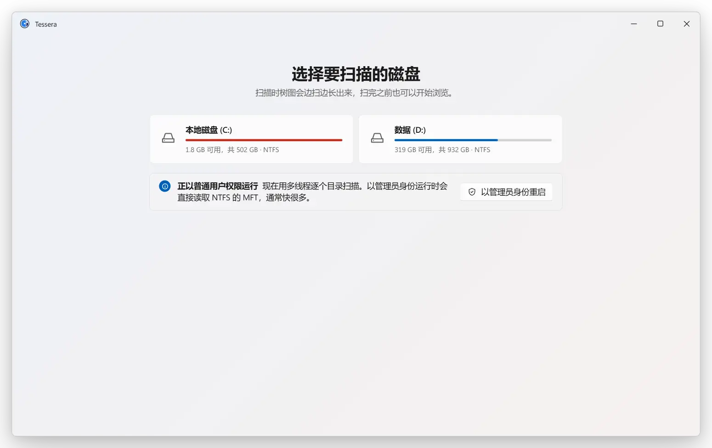

<div align="center">


<h1>Tessera</h1>

<p><b>轻量、快速的 Windows 磁盘空间可视化工具。</b><br>
扫描一个盘，把每个文件夹画成矩形树图，删掉不需要的东西。</p>

<p>
<a href="https://github.com/4zuma/tessera/releases/latest"></a>

<a href="#许可证"></a>
</p>

<p><a href="https://github.com/4zuma/tessera/releases/latest"><b>下载</b></a> · <a href="README.md">English</a> · 简体中文</p>

</div>

<picture>
  <source media="(prefers-reduced-motion: reduce) and (prefers-color-scheme: dark)" srcset="docs/readme/still-zh-dark.webp">
  <source media="(prefers-reduced-motion: reduce)" srcset="docs/readme/still-zh-light.webp">
  <source media="(prefers-color-scheme: dark)" srcset="docs/readme/demo-zh-dark.webp">
  
</picture>

## 特点

* **快。** 不需要管理员权限，约 8 秒扫完一个有 330 万个文件的系统盘；以管理员身份运行时直接读取 NTFS 主文件表（MFT），约 2 秒。
* **轻。** 扫完这个盘后，整个程序约占 300 MB 内存；之后在后台跟踪文件变化，几乎不占 CPU。
* **流畅。** 矩形树图的动画是 60 fps。双击文件夹放大，按 Backspace 返回上一级。
* **实时。** 扫描之后有文件变化，半秒左右就会反映到图上。
* **删除有退路。** 移到回收站后可以按 Ctrl+Z 撤销，永久删除前会先确认。文件被占用或受保护时，Tessera 会告诉你原因。
* **Windows 原生外观。** Windows 11 上的 Mica 材质、系统强调色、浅色和深色模式，资源管理器的右键菜单也只差一步。界面跟随 Windows 语言，支持英文和简体中文。
* **免安装，免费。** 只有一个 exe：不用安装，不用注册，没有广告，完全开源。

## 下载

从 [Releases](https://github.com/4zuma/tessera/releases/latest) 下载最新的 `tessera-…-windows-x64.exe`（Arm 电脑用 `…-arm64.exe`），直接运行就行，不用安装。

* Windows 10 或 11，x64 或 Arm64。
* 需要 WebView2 运行时。Windows 11 自带，保持更新的 Windows 10 也已经有了。
* exe 暂时没有代码签名，第一次运行时 SmartScreen 可能会拦一下：点“更多信息”，再点“仍要运行”。
* 以管理员身份运行（或者在 Tessera 里点“以管理员身份重启”）可以用更快的 MFT 扫描；没有管理员权限时，Tessera 会逐个文件夹遍历。

## 和 SpaceSniffer 对比

完整扫描一个约有 330 万个文件和文件夹的系统盘，两个工具在同一台电脑上测（Windows 11、Ryzen 9 7945HX、NVMe 固态硬盘）：

| | Tessera 1.1 | SpaceSniffer |
|---|--:|--:|
| 扫描时间，无管理员权限 | 8.1 秒 | 318 秒 |
| 扫描时间，管理员（MFT） | 2.2 秒 | 未测 |
| 扫描后内存，整个程序 | 292 MB | 1,447 MB |
| 空闲时 CPU | 约单核 1% | 单核 12–23% |

Tessera 的扫描时间来自 `tessera bench`，文件缓存已热；内存是整个程序（含 WebView2）在默认窗口大小下的占用。

## 操作

| | |
|---|---|
| 双击、<kbd>Enter</kbd> | 放大文件夹 |
| <kbd>Backspace</kbd> | 返回上一级 |
| 方向键 | 移动选择 |
| <kbd>Delete</kbd> | 移到回收站（<kbd>Ctrl</kbd>+<kbd>Z</kbd> 撤销） |
| <kbd>Shift</kbd>+<kbd>Delete</kbd> | 确认后永久删除 |
| <kbd>Ctrl</kbd>+<kbd>C</kbd> | 复制选中项的路径 |
| <kbd>F5</kbd> | 重新扫描 |
| 右键 | Tessera 的菜单，“显示更多选项”里是资源管理器的菜单 |

全部快捷键和鼠标操作见 [`app/README.md`](app/README.md)（英文）。

## 从源码构建

需要 Rust 1.90 或更新版本，以及 Node.js。

```sh
cd app
npm install
npx tauri build    # ../target/release/tessera-app.exe
```

扫描器、文件树和矩形树图的原理，命令行工具、测试、CI 和发布流程，见 [`docs/development.md`](docs/development.md)（英文）。

## 许可证

Tessera 采用 [MIT](LICENSE-MIT) 或 [Apache-2.0](LICENSE-APACHE) 双许可证，任选其一。
