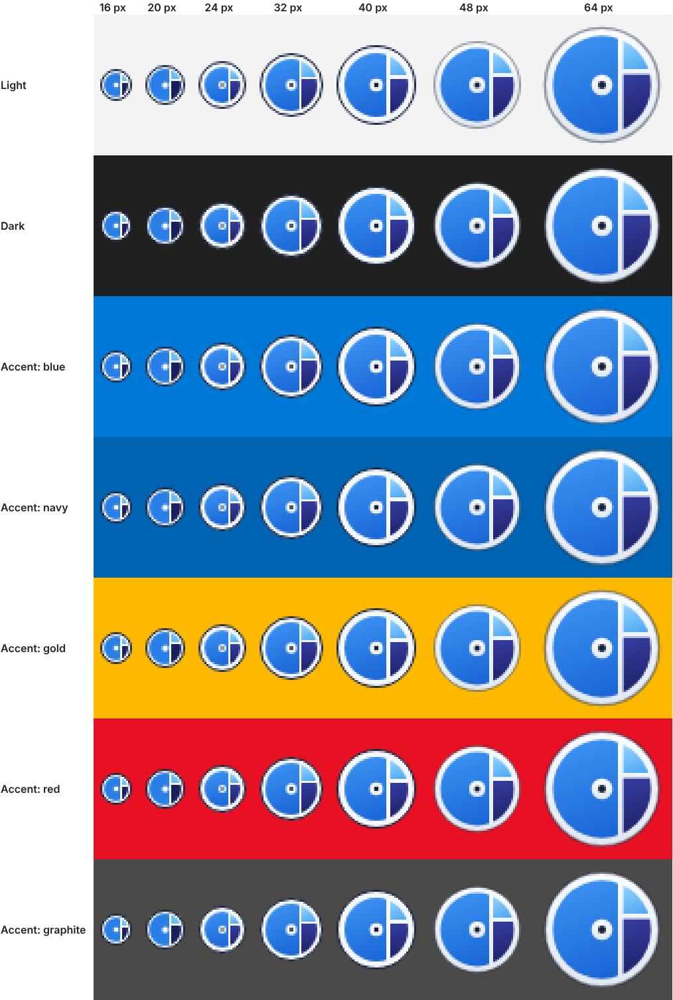

# Tessera logo

A disc, a disk platter seen from above, holding a three-tile treemap, with a hub at
the centre. (A tessera is one tile of a mosaic.)



## Files

| File | What it is |
|---|---|
| `tessera.svg` | Master artwork on a 48 grid. Used from 48 px up and in the README. |
| `tessera-16.svg` … `tessera-40.svg` | The small sizes, each drawn on its own pixel grid so gaps and edges land on whole pixels. |
| `sizes.png` | Every size, magnified 3×, on light, dark and accent-coloured backgrounds. |

`scripts/brand-icons.mjs` writes all of these, plus the app icons in
`app/src-tauri/icons/` (`icon.ico` holds 16 to 256 px) and `app/public/favicon.png`.
Change the script, not the files, then run it:

```sh
npm i -g playwright && npx playwright install chromium   # once
node scripts/brand-icons.mjs
```

`app/src/components/Logo.svelte` (the browser preview's title bar) repeats the 16 px
artwork; keep it in step.

## Construction

* From the outside in: a dark ring, a white rim, the tile disc, and the hub at the centre.
* On the 48 grid the vertical gap is centred on x = 31 and the right-hand gap on y = 19,
  so the corner where they meet stays clear of the hub.
* Up to 40 px: a solid 1 px dark ring; flat colours and a light dot for the hub at 16 and 20 px.
* From 48 px: the ring at 45 % opacity, and each tile gets a 120° gradient, light from the
  top left, as in Windows 11 app icons.

## Colours

| Part | Colour (from 48 px) | Flat (16 and 20 px) |
|---|---|---|
| Ring, hub dot | `#14213A` | `#14213A` |
| Rim, gaps, hub | `#FAFCFF` → `#E1E8F1` | `#F4F7FB` |
| Large tile | `#3C93F2` → `#1A66D6` | `#2A7FE6` |
| Upper tile | `#9AD6FF` → `#4FA8F2` | `#6CBBF7` |
| Lower tile | `#353C9E` → `#1B1F62` | `#1B1F5E` |

These colours belong to the logo only. Inside the app, accents follow the Windows accent colour.

## Why it looks like this

A portable exe carries one `.ico` for every theme, and Windows can paint title bars in
the accent colour, which is almost always a mid-tone. So the icon brings its own
contrast: the dark ring holds the outline on light backgrounds and accent colours, the
white rim on dark ones, and the tiles stay away from mid-tones. At 16 px, 57 % of the
icon's area has 3:1 contrast on the light theme (`#F3F3F3`) and 73 % on the dark theme
(`#202020`); Microsoft's [app icon guidance](https://learn.microsoft.com/windows/apps/design/iconography/app-icon-design)
asks for at least half. The outline keeps 3:1 against light, dark and the Windows 10
accent colours.

Don't recolour, stretch or add effects to the logo, and below 48 px use the small
artwork for that size rather than scaling the master down.
